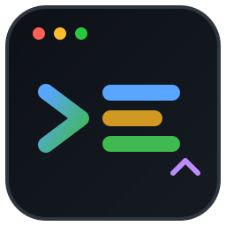
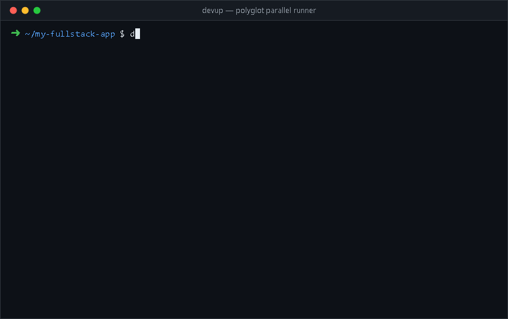

<p align="center">
  
</p>

# devup

[](https://github.com/devup-cli/devup/actions/workflows/ci.yml)
[](https://pypi.org/project/devup-cli/)
[](https://pypi.org/project/devup-cli/)
[](https://pypi.org/project/devup-cli/)
[](LICENSE)

**Zero-dependency polyglot script discovery and multi-service parallel runner.**

`devup` scans your repository for runnable scripts and services across `devup.toml`, `package.json`, `pyproject.toml`, `Cargo.toml`, `go.mod` / `go.work`, `Taskfile.yml`, `mise.toml`, `pom.xml` (Maven), `build.gradle(.kts)` (Gradle), `Justfile`, `Makefile`, and `docker-compose.yml`, then runs one or many of them concurrently with color-coded prefixed logs and clean process-tree shutdown on `Ctrl+C`.

Try it in 5 seconds with no permanent install:

```bash
uvx --from devup-cli devup list
```



Zero third-party runtime dependencies — pure Python 3.11+ standard library.

## Why `devup`?

| Feature | `devup` | `concurrently` | `honcho` | `mprocs` | `just` |
| :--- | :---: | :---: | :---: | :---: | :---: |
| Zero-config polyglot discovery (`package.json`, `pyproject.toml`, `pom.xml`, `build.gradle`, `Makefile`, `Justfile`, Compose) | Yes | — | — | — | — |
| Parallel execution + colored `[service]` logs | Yes | Yes | Yes | TUI | — |
| HTTP (`ready_url`) & TCP (`ready_tcp`) startup readiness | Yes | — | — | — | — |
| Built-in `.env` loading & port conflict pre-check | Yes | — | `.env` only | — | `.env` only |
| Interactive multi-select picker (`devup pick`) & `--watch` | Yes | — | — | TUI | — |
| Zero external runtime dependencies | Yes (Python 3.11+) | Needs Node | Yes | Native binary | Native binary |

## Features

- **Polyglot auto-discovery:**
  - `package.json` (automatically detects `pnpm`, `yarn`, `bun`, or `npm` from lockfiles, plus `workspaces` monorepos)
  - `pyproject.toml` (supports Poe the Poet, PDM, Hatch, Poetry scripts, and `[project.scripts]`)
  - `pom.xml` (Maven lifecycle goals, Spring Boot / Quarkus / Exec plugins, `mvnw` / `mvnw.cmd` wrappers, and `<modules>`)
  - `build.gradle` / `build.gradle.kts` (Gradle tasks, `bootRun`, `run`, `gradlew` / `gradlew.bat` wrappers, and `settings.gradle(.kts)` subprojects)
  - `Cargo.toml` (Cargo workspace members, `[[bin]]` / `[[example]]` targets, `[package.metadata.scripts]`, plus `build`/`run`/`test`/`check`/`clippy`/`fmt`)
  - `go.mod` / `go.work` (Go module `build`/`test`/`vet`, root/cmd entrypoints `go run ./cmd/<name>`, and multi-module workspaces)
  - `Taskfile.yml` / `Taskfile.yaml` (`task <name>` recipes + descriptions, skipping `internal: true`)
  - `mise.toml` / `.mise.toml` / `.config/mise.toml` (`mise run <name>` tasks + descriptions, skipping `hide = true`)
  - `Justfile` / `justfile` (recipes + doc comments)
  - `Makefile` / `GNUmakefile` (targets + `#` / `##` doc comments)
  - `compose.yaml` / `docker-compose.yml` (`compose:up`, `compose:down`, and per-service `compose:<service>`)
  - `devup.toml` (custom tasks, service groups, defaults, working directories, env vars, `depends_on`, and readiness checks)
- **Parallel runner with readable logs:**
  - Distinct ANSI colors and aligned `[service]` prefixes per process
  - Log filtering (`--only` / `--exclude`), per-service contiguous output (`--buffer group`), persistent log capture (`--save-logs`), `-v`/`--verbose`/`DEVUP_DEBUG=1` trace output, `--timestamps`, and `--no-prefix`
- **Clean shutdown & fail-fast:**
  - Stops all sibling services if one crashes (override with `--keep-going`)
  - Kills full process trees on `Ctrl+C` (process groups on POSIX; `CTRL_BREAK_EVENT` + `taskkill /T` fallback on Windows) so child reloaders don't leak ports
- **Built-in `.env` loading:**
  - Automatically loads `.env` from the project root (without overriding variables already exported in your shell)
  - Supports `env_file` at both workspace and per-task levels in `devup.toml`, plus `--env-file` and `--no-dotenv` CLI flags
- **Port availability pre-check:**
  - Checks declared (`port` / `ports`) or inferred (`--port`, `PORT=`) ports before launch, warns with the owning PID/process if a port is occupied, or aborts with `--strict-ports`
- **Watch & auto-restart (`--watch` / `-w`):**
  - Polls watched files (zero external dependencies) and restarts services cleanly when source files change
- **Interactive arrow-key picker (`devup pick`):**
  - Multi-select tasks/groups with `Up`/`Down`, `Space`, and `Enter` in a TTY (with numbered input fallback)
- **Dependency & readiness ordering:**
  - Start `web` only after `api` passes an HTTP `ready_url` (`2xx`/`3xx`), TCP `ready_tcp` / `ready_port` probe, log `ready_pattern` regex, or after a build task finishes cleanly

## Installation

```bash
# Run once without installing (via uv or npx)
uvx --from devup-cli devup --help
# or with Node.js 20+ (no Python required)
npx @devup-cli/devup --help

# Install globally with pipx, uv, or npm (recommended)
pipx install devup-cli
# or
uv tool install devup-cli
# or
npm install -g @devup-cli/devup

# Or directly from GitHub
pipx install git+https://github.com/devup-cli/devup.git

# Or install locally from a cloned checkout
pip install -e .

# Homebrew (macOS / Linux — install from packaging/homebrew/devup-cli.rb via a local tap)
TAP_DIR="$(brew --repository)/Library/Taps/devup-cli/homebrew-tap"
mkdir -p "$TAP_DIR/Formula" && cp packaging/homebrew/devup-cli.rb "$TAP_DIR/Formula/"
brew install --build-from-source devup-cli/tap/devup-cli

# Scoop (Windows — requires Python 3.11+ via Scoop's main bucket)
scoop bucket add main
scoop install https://raw.githubusercontent.com/devup-cli/devup/main/packaging/scoop/devup.json
# Or from a cloned checkout (note Windows backslashes):
scoop install .\packaging\scoop\devup.json

# Portable single-file zipapp (requires Python 3.11+)
curl -LO https://github.com/devup-cli/devup/releases/latest/download/devup.pyz
python devup.pyz --help
```

### Shell Autocompletion

```bash
# Bash
source <(devup completion bash)
# Zsh
source <(devup completion zsh)
# Fish
devup completion fish | source
# PowerShell
devup completion powershell | Out-String | Invoke-Expression
```

## Quick Start

```bash
# List all discovered scripts and groups in the current repo
devup list

# Run multiple discovered tasks side by side
devup run api web worker
# Shorthand (when names don't collide with subcommands):
devup api web worker

# Run with auto-restart on file changes and extra env file
devup -w --env-file .env.local api web

# Abort startup if any declared port is already occupied
devup --strict-ports api web

# Interactive picker (also opens automatically when running `devup` in a TTY with no default)
devup pick

# Preview execution plan without spawning processes
devup --dry-run api web

# Generate a starter devup.toml
devup init
```

## Configuration (`devup.toml`)

`devup` works out of the box without configuration, and you can add `devup.toml` to define service groups, `.env` files, ports, file watching, startup order, or readiness checks:

```toml
default = ["dev"]
fail_fast = true
strict_ports = false
auto_env = true
env_file = [".env", ".env.local"]
shutdown_timeout = 5.0

[env]
LOG_LEVEL = "info"

[groups]
dev = ["db", "api", "web"]

[tasks.db]
command = "docker compose up postgres"
port = 5432
ready_tcp = "127.0.0.1:5432"
ready_timeout = 30
ready_pattern = "database system is ready to accept connections"

[tasks.api]
command = "uvicorn app.main:app --reload --port 8000"
cwd = "backend"
port = 8000
env_file = ".env.api"
depends_on = ["db"]
ready_url = "http://127.0.0.1:8000/health"
ready_timeout = 20
watch = ["app/**/*.py"]
env = { PORT = "8000" }

[tasks.web]
command = "npm run dev"
cwd = "frontend"
port = 5173
depends_on = ["api"]
```

## Documentation

* [Documentation Website](https://devup-cli.github.io/devup/)
* [5-Minute Getting Started](docs/getting-started.md)
* [CLI Command Reference](docs/cli-reference.md)
* [`devup.toml` Configuration Reference](docs/configuration.md)
* [Manifest Scanners & Discovery](docs/scanners.md)
* [Architecture Overview](docs/architecture.md)
* [Troubleshooting & FAQ](docs/troubleshooting.md)
* [Examples](examples/README.md)

## Running Tests

```bash
python -m unittest discover -s tests -v
python scripts/check_coverage.py --min-coverage 65
cd packages/npm && npm run test:coverage
```
